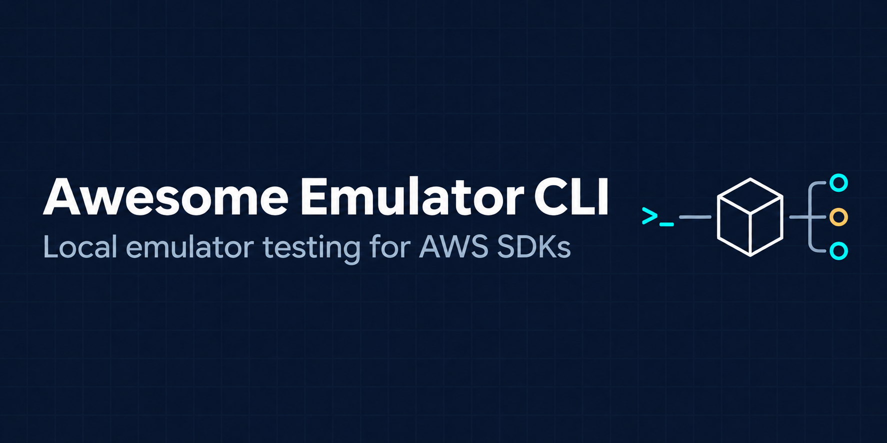

# Awesome Emulator CLI

<p align="center">
  
</p>

Awesome Emulator CLI runs AWS Emulator in Docker and supplies connection settings to your test command. The CLI is distributed with Node.js, but the project under test can use any AWS SDK language and does not need to be a Node.js project.

This is an independent project and is not affiliated with or endorsed by Amazon Web Services.

## Requirements

- Node.js 22 or later
- Docker Engine or Docker Desktop
- x86_64/amd64 or ARM64/aarch64

Node.js is required to run the CLI. Your application and test project can use any language.

On first start, Docker downloads the selected AWS Emulator RPM and its signature, verifies the signature, and builds a local image. Later starts reuse the image for that version and architecture.

Prepare the image ahead of the first test run with:

```sh
npx awesome-emulator prepare
```

This builds or reuses the same versioned image as `start` and `run`, without starting a container or creating emulator state files. It can be run during CI setup or alongside other independent setup work so image construction does not delay the first test command. Pass `--version` or set `AWS_EMULATOR_VERSION` when you want to prepare a specific release.

## Run a test command

```sh
npm install --save-dev awesome-emulator-cli
npx awesome-emulator run -- npm test
```

`run` starts the emulator, supplies the connection settings to the child process, then stops the container. Use `--version` to select a release and `--port 0` to choose a free local port. Run `npx awesome-emulator --help` for all options.

### Run non-Node projects

You can run an existing project command even when the project has no `package.json`. Use `npm exec` to download the CLI for the run:

```sh
npm exec --yes --package=awesome-emulator-cli -- awesome-emulator run -- python -m pytest
```

The same pattern works with other SDK projects:

```sh
# AWS CLI v2, Boto3, and AWS SDK for Go v2 use AWS_CA_BUNDLE automatically.
npm exec --yes --package=awesome-emulator-cli -- awesome-emulator run -- aws sts get-caller-identity
npm exec --yes --package=awesome-emulator-cli -- awesome-emulator run -- python -m pytest
npm exec --yes --package=awesome-emulator-cli -- awesome-emulator run -- go test ./...

# AWS SDK for JavaScript v3 uses NODE_EXTRA_CA_CERTS, which the CLI sets by default.
npm exec --yes --package=awesome-emulator-cli -- awesome-emulator run -- npm test

# Java, Rust, and .NET need an additional TLS setting.
npm exec --yes --package=awesome-emulator-cli -- awesome-emulator run --sdk java-v2 -- ./mvnw -B -o test
npm exec --yes --package=awesome-emulator-cli -- awesome-emulator run --sdk rust -- cargo test --offline
npm exec --yes --package=awesome-emulator-cli -- awesome-emulator run --sdk dotnet -- dotnet test --no-restore
```

Resolve Java, Rust, and .NET dependencies before the wrapped command when they are not already cached. For example, run `./mvnw -B dependency:go-offline`, `cargo fetch`, or `dotnet restore` before starting the emulator.

The repository runs an integration smoke check for AWS CLI v2, Boto3, AWS SDK for JavaScript v3, Java 2.x, Go v2, Rust, and .NET. It verifies that each client reaches the emulator's STS endpoint with TLS enabled and receives the emulator account ID.

The common child environment sets `AWS_ENDPOINT_URL`, the emulator credentials and config files, `AWS_CA_BUNDLE`, and the region. The CLI removes inherited credential variables, profile selectors, and service-specific endpoint variables so those host environment settings cannot redirect or authenticate the test. `AWS_DISABLE_HOST_PREFIX_INJECTION` is enabled for SDKs that otherwise rewrite the local host. The wrapper manages inherited environment and JVM option variables; project code or build configuration that explicitly sets credentials or endpoints must be configured for the emulator.

Use `--sdk` only when a process needs SDK-specific TLS configuration. It can be repeated when one command runs more than one SDK:

| SDK | TLS configuration |
| --- | --- |
| AWS CLI v2, Boto3, AWS SDK for Go v2 | `AWS_CA_BUNDLE` |
| AWS SDK for JavaScript v3 | `NODE_EXTRA_CA_CERTS` |
| AWS SDK for Java 2.x | `--sdk java-v2` adds the emulator `truststore.p12` to `JAVA_TOOL_OPTIONS` |
| AWS SDK for Rust | `--sdk rust` sets `SSL_CERT_FILE` to `ca.pem` |
| AWS SDK for .NET | `--sdk dotnet` sets `SSL_CERT_FILE` to `ca.pem` |

Java's `JAVA_TOOL_OPTIONS` applies to every JVM started by the child command, including Maven or Gradle and test workers. Resolve Java build dependencies before invoking `awesome-emulator run`, or use a truststore that contains both the emulator certificate and the certificates for other HTTPS hosts. The emulator truststore contains only the emulator certificate, so HTTPS calls to Maven Central, AWS, or other hosts can fail while it is active. The CLI appends to existing `JAVA_TOOL_OPTIONS`; if `JAVA_TOOL_OPTIONS`, `JDK_JAVA_OPTIONS`, or `_JAVA_OPTIONS` already sets `javax.net.ssl.trustStore`, it preserves that truststore. If only `javax.net.ssl.trustStoreType=PKCS12` is set, the CLI adds the emulator truststore path and preserves the type. An incompatible truststore type requires a custom truststore path. A preserved truststore must also trust the emulator. `MAVEN_OPTS` and `GRADLE_OPTS` remain in their own variables; if either sets a separate truststore, make sure the Java test JVM trusts the emulator too.

The AWS SDK for Java gives JVM system properties precedence over environment variables. When `--sdk java-v2` is selected, the CLI checks inherited `JAVA_TOOL_OPTIONS`, `JDK_JAVA_OPTIONS`, `_JAVA_OPTIONS`, `JAVA_OPTS`, `MAVEN_OPTS`, `GRADLE_OPTS`, `ANT_OPTS`, and `SBT_OPTS` values and rejects AWS credential, profile, or endpoint properties and `@argument-file` references so inherited JVM options cannot bypass the emulator settings.

`AWS_CA_BUNDLE` and `SSL_CERT_FILE` replace the default CA bundle for SDKs that read them. If the same process must contact other HTTPS services, create a combined bundle with the emulator CA and the roots it needs. `NODE_EXTRA_CA_CERTS` is additive to Node.js's default trust roots.

Child commands run without a shell by default, so each argument is passed as data. On Windows, `.cmd` and `.bat` launchers such as `npm`, and shell built-ins such as `echo` and `dir`, require an explicit shell opt-in:

```sh
npx awesome-emulator run --shell -- npm test
```

Use `--shell` only with trusted command and argument values. Shell metacharacters are interpreted in this mode. Node.js API callers can opt in with `runWithEmulator(command, args, { shell: true })` under the same restriction.

## Use from Node.js

Use the API when your test harness needs to control the emulator lifecycle directly:

```js
import { startEmulator } from "awesome-emulator-cli";

const emulator = await startEmulator({ port: 0, telemetry: "off" });
try {
  console.log(emulator.endpointUrl, emulator.environment);
} finally {
  await emulator.stop();
}
```

Pass an `AbortSignal` as `signal` to cancel image building or startup. `NODE_EXTRA_CA_CERTS` is read when Node.js starts. For an already-running Node.js process, configure the AWS SDK's HTTPS handler with `emulator.caFile`; use `awesome-emulator run` when you want the wrapper to start a child process with TLS settings already applied.

## Local files and telemetry

The emulator writes its config, credentials, and CA certificate under `~/.aws/emulator/<port>/` (Windows: `%USERPROFILE%\.aws\emulator\<port>\`). The emulator keeps resources in memory; a clean stop removes the per-port files and resources.

Telemetry is on by default. AWS says it collects aggregate usage and error data, not requests, responses, code, credentials, or personal data. Turn it off for a run with:

```sh
npx awesome-emulator run --telemetry off -- npm test
```

Read the [AWS Emulator telemetry details](https://docs.aws.amazon.com/emulator/latest/userguide/telemetry.html) before choosing whether to leave telemetry on.

AWS Emulator is for building and testing. Do not use it for production workloads or security testing. See the [official limitations](https://docs.aws.amazon.com/emulator/latest/userguide/) and [security guidance](https://docs.aws.amazon.com/emulator/latest/userguide/security.html).

See [CONTRIBUTING.md](./CONTRIBUTING.md) to contribute and [SECURITY.md](./SECURITY.md) to report a vulnerability.

## License

MIT. See [LICENSE](./LICENSE). This license covers the wrapper; downloaded AWS Emulator binaries retain their own license and notices.
