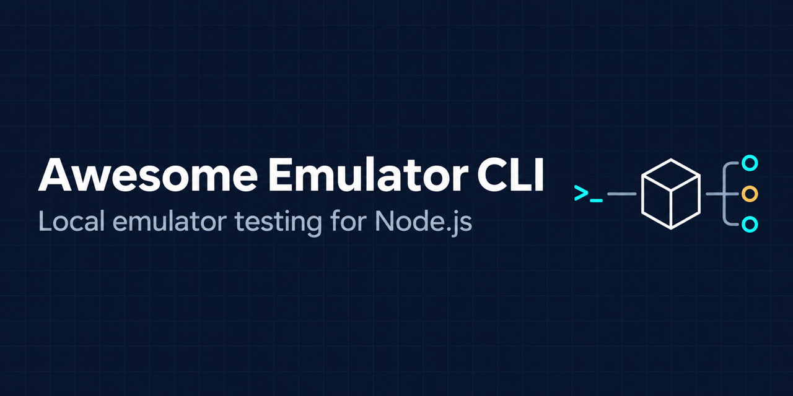

# Awesome Emulator CLI

<p align="center">
  
</p>

Awesome Emulator CLI for use with AWS Emulator in local tests from npm scripts or Node.js. It runs the upstream Linux package in Docker.

This is an independent project and is not affiliated with or endorsed by Amazon Web Services.

## Requirements

- Node.js 22 or later
- Docker Engine or Docker Desktop
- x86_64/amd64 or ARM64/aarch64

On first start, Docker downloads the selected AWS Emulator RPM and its signature, verifies the signature, and builds a local image. Later starts reuse the image for that version and architecture.

## Run a test command

```sh
npm install --save-dev awesome-emulator-cli
npx awesome-emulator run -- npm test
```

`run` starts the emulator, supplies the connection settings to the child process, then stops the container. Use `--version` to select a release and `--port 0` to choose a free local port. Run `npx awesome-emulator --help` for all options.

Child commands run without a shell by default, so each argument is passed as data. On Windows, `.cmd` and `.bat` launchers such as `npm`, and shell built-ins such as `echo` and `dir`, require an explicit shell opt-in:

```sh
npx awesome-emulator run --shell -- npm test
```

Use `--shell` only with trusted command and argument values. Shell metacharacters are interpreted in this mode. Node.js API callers can opt in with `runWithEmulator(command, args, { shell: true })` under the same restriction.

## Use from Node.js

Use the API when your test harness needs to control the emulator lifecycle directly:

```js
import { startEmulator } from "awesome-emulator-cli";

const emulator = await startEmulator({ port: 0, telemetry: "off" });
try {
  console.log(emulator.endpointUrl, emulator.environment);
} finally {
  await emulator.stop();
}
```

Pass an `AbortSignal` as `signal` to cancel image building or startup. `NODE_EXTRA_CA_CERTS` is read when Node.js starts. For an already-running Node.js process, configure the AWS SDK's HTTPS handler with `emulator.caFile`; use `awesome-emulator run` when you want the wrapper to start a child process with TLS settings already applied.

## Local files and telemetry

The emulator writes its config, credentials, and CA certificate under `~/.aws/emulator/<port>/` (Windows: `%USERPROFILE%\.aws\emulator\<port>\`). The emulator keeps resources in memory; a clean stop removes the per-port files and resources.

Telemetry is on by default. AWS says it collects aggregate usage and error data, not requests, responses, code, credentials, or personal data. Turn it off for a run with:

```sh
npx awesome-emulator run --telemetry off -- npm test
```

Read the [AWS Emulator telemetry details](https://docs.aws.amazon.com/emulator/latest/userguide/telemetry.html) before choosing whether to leave telemetry on.

AWS Emulator is for building and testing. Do not use it for production workloads or security testing. See the [official limitations](https://docs.aws.amazon.com/emulator/latest/userguide/) and [security guidance](https://docs.aws.amazon.com/emulator/latest/userguide/security.html).

See [CONTRIBUTING.md](./CONTRIBUTING.md) to contribute and [SECURITY.md](./SECURITY.md) to report a vulnerability.

## License

MIT. See [LICENSE](./LICENSE). This license covers the wrapper; downloaded AWS Emulator binaries retain their own license and notices.
